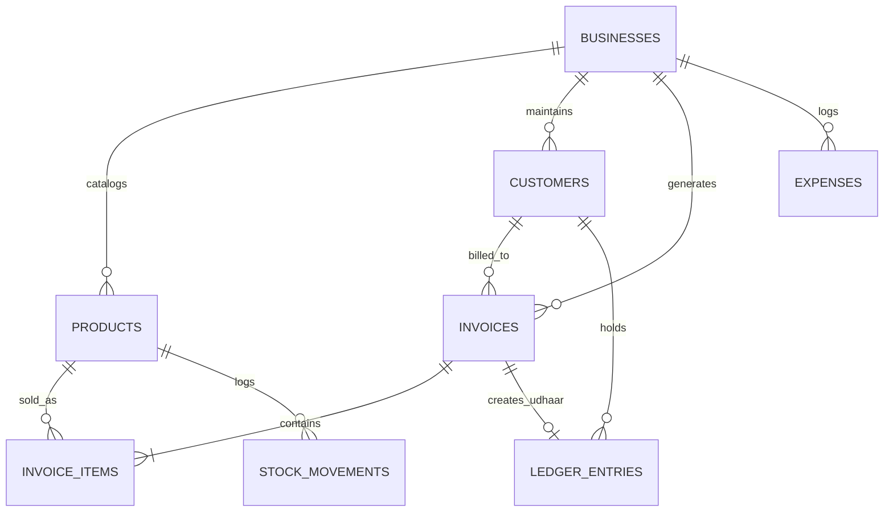

# LEDGE PRO — Project Documentation & CA-3 Academic Deliverable
## B.E. Computer Science & Engineering | Semester 3 | Programming in Java
**Chitkara University, Punjab**

---

### 1. Project Title
**LEDGE PRO: Premium Business Management, Inventory Control, POS Billing & Digital Khata Platform**
*Tagline: "Your Business. One Smart Ledger."*

---

### 2. Abstract
Indian micro, small, and medium enterprises (MSMEs), ranging from neighbourhood kirana stores to wholesale distributors, have historically relied on error-prone paper ledgers (*bahi-khata*) and fragmented tools to track sales, credit lines (*udhaar*), and inventory movements. Existing commercial software is either overly complicated, expensive, or fails to link point-of-sale billing directly with customer credit ledgers. 

**LEDGE PRO** bridges this critical gap by delivering a unified, high-performance platform that synchronizes point-of-sale billing, real-time multi-criteria inventory tracking, double-entry digital customer khata ledgers, and stream-driven business intelligence. Engineered using **Java 21** as the core backend, the system demonstrates pure JDBC persistence, explicit ACID transaction management, multithreaded background processing, and object-oriented architectural patterns without relying on opaque ORMs.

---

### 3. Problem Statement
Small and medium retailers in India face three chronic operational bottlenecks:
1. **Unsynchronized Udhaar Credit & Invoicing**: When credit is extended on paper notebooks, disputes over payments and balances occur frequently, causing working capital bleed.
2. **Stock Discrepancies & Stockouts**: Failure to automatically deduct inventory during sales leads to unexpected out-of-stock scenarios for fast-moving consumer goods.
3. **Misleading Financial Perception**: Business owners often mistake daily cash collections for actual profit, failing to separate gross turnover from cost of goods sold and store operating expenses.

---

### 4. Project Objectives
- Implement an atomic point-of-sale checkout engine in Java that guarantees stock decrement, invoice creation, and khata credit balance updates either all succeed or all roll back.
- Build a persistent, double-entry style digital customer ledger (*Khata*) providing permanent transaction audit trails and downloadable statements.
- Visibly implement and showcase core concepts from the Chitkara University Java syllabus: Object-Oriented Programming, Collections Framework, Custom Exceptions, Multithreading & ExecutorService, raw JDBC, Lambda Expressions, and the Stream API.
- Provide a modern, fintech-grade React & TypeScript dashboard with sub-second responsiveness.

---

### 5. System Architecture Diagram

```
┌─────────────────────────────────────────────────────────────┐
│                 React 18 + TypeScript Client               │
│  (Dashboard, POS Billing Terminal, Digital Khata, Reports)  │
└──────────────────────────────┬──────────────────────────────┘
                               │ HTTP REST (JSON)
┌──────────────────────────────▼──────────────────────────────┐
│                    Java 21 REST Layer                       │
│  com.ledgepro.controller (Dashboard, POS, Khata, Reports)   │
└──────────────────────────────┬──────────────────────────────┘
                               │
┌──────────────────────────────▼──────────────────────────────┐
│                   Business Service Layer                    │
│  POSBillingService, KhataLedgerService, ProductService      │
│  ReportAnalyticsService (Streams/Lambdas), ConcurrencyPool  │
└──────────────────────────────┬──────────────────────────────┘
                               │ Explicit ACID Transactions
┌──────────────────────────────▼──────────────────────────────┐
│                  Pure JDBC DAO Data Layer                   │
│  ProductDAOImpl, CustomerDAOImpl, InvoiceDAOImpl            │
│  LedgerDAOImpl, ExpenseDAOImpl, DatabaseConnectionFactory   │
└──────────────────────────────┬──────────────────────────────┘
                               │ PreparedStatement (SQL)
┌──────────────────────────────▼──────────────────────────────┐
│                 MySQL 8.x Relational Engine                 │
│         (Users, Products, Invoices, Khata Ledger)           │
└─────────────────────────────────────────────────────────────┘
```

---

### 6. Entity Relationship (ER) & Relational Schema



---

### 7. Java Course Concept Implementation Details

| Java Concept | File Reference | Exact Implementation |
| :--- | :--- | :--- |
| **Encapsulation & Inheritance** | `BaseEntity.java`, `Product.java`, `Customer.java`, `Invoice.java` | Protected fields, getter/setter data shielding, polymorphic method overrides (`compareTo`). |
| **Collections Framework** | `ProductService.java`, `CartService`, `ReportService` | `ConcurrentHashMap` for catalog cache, `ArrayList` for batch item retrieval, `Comparator` for sorting by price and stock. |
| **Custom Exceptions** | `InsufficientStockException.java`, `LedgeProException.java` | Checked/unchecked exception hierarchy, status codes, try-with-resources. |
| **Multithreading** | `ReportThreadPoolManager.java`, `LowStockMonitorService.java` | `ExecutorService`, `ThreadPoolExecutor`, `Callable<String>` returning `Future<String>`, background daemon thread polling stock with `synchronized` locks. |
| **JDBC Transactions** | `InvoiceDAOImpl.java`, `DatabaseConnectionFactory.java` | `conn.setAutoCommit(false)`, `conn.commit()`, `conn.rollback()` ensuring atomic POS billing where stock deduction and customer udhaar updates are completely transactional. |
| **Stream API & Lambdas** | `ReportAnalyticsService.java` | `filter()`, `map()`, `sorted()`, `distinct()`, `reduce()`, `Collectors.groupingBy()`, `Collectors.summarizingDouble()`. |
| **Generics** | `GenericDAO<T, ID>`, `GenericResponse<T>`, `GenericResult<T>` | Type-safe envelopes and interfaces. |
| **File I/O** | `CsvUtils.java` | `BufferedReader`, `BufferedWriter`, `StringWriter` with try-with-resources for CSV product catalog import/export. |

---

### 8. Testing Strategy & Results
The platform includes automated JUnit 5 test cases executing against the actual JDBC engine:
1. `testProductLifecycle()`: Validates CRUD and persistence.
2. `testPOSBillingAndStockDeduction()`: Verifies atomic stock deduction upon completing checkout.
3. `testInsufficientStockThrowsException()`: Asserts that attempting to sell more items than available stock triggers `InsufficientStockException` and causes a complete database rollback.
4. `testKhataCreditSaleAndPaymentSettlement()`: Validates that an udhaar sale increases customer debt and a subsequent partial payment deducts the balance to the exact rupee.
5. `testKhataRequiresCustomer()`: Verifies that credit sales without a registered customer account are rejected.

**Test Execution Outcome:**
`Tests run: 5, Failures: 0, Errors: 0, Skipped: 0 — BUILD SUCCESS`
